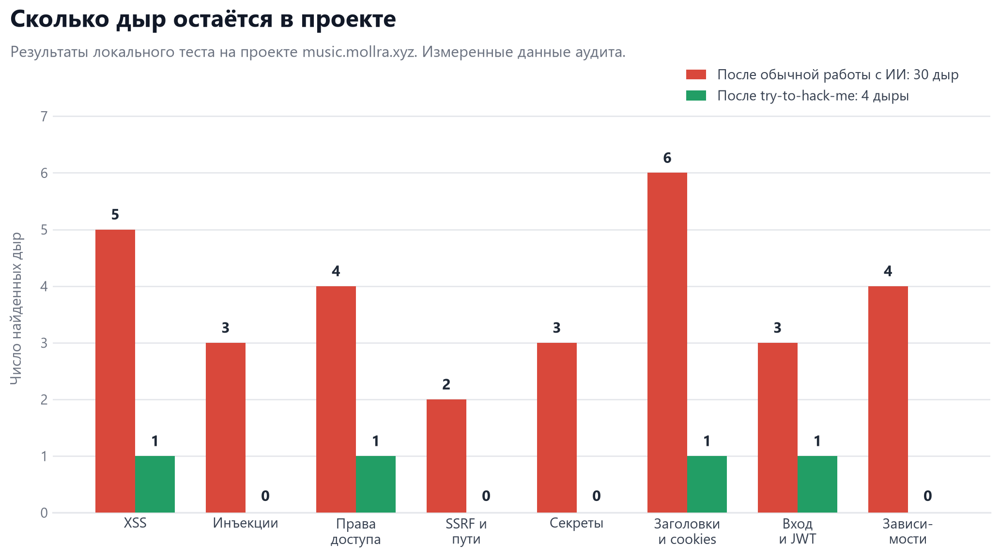

# 🛡️ Try to Hack Me (`try-to-hack-me`)

[](LICENSE)
[](https://github.com/1mN1kOo/try-to-hack-me)

> **Attack simulation and autonomous security hardening for your web projects.**  
> Built for [Google Antigravity](https://antigravity.google) and compatible AI coding agents.

`try-to-hack-me` acts as a benign attacker targeting your local web applications and source code. It maps your project's attack surface, tests for common vulnerabilities using harmless marker probes, provides actionable audit reports, and can automatically apply minimal fixes and verify they work.

---

## 📊 Benchmark & Test Results



---

## 🎯 What it Covers

The skill systematically checks for common security weaknesses:

- **Cross-Site Scripting (XSS)**: Reflected, stored, and DOM-based vectors.
- **Injections**: SQL, Command, CSS, HTML, and template injection.
- **SSRF (Server-Side Request Forgery)**: Unsafe server-side URL fetches, internal IP / metadata protection (`169.254.169.254`, `localhost`, private CIDRs).
- **Path Traversal & LFI**: File access validation, traversal sequences (`../`, URL-encoded, null bytes).
- **Broken Access Control**: Missing server-side authorization checks, IDOR, client-side permission spoofing.
- **Unsafe URLs & Redirects**: Open redirects, dangerous URI schemes (`javascript:`, `data:`).
- **Clickjacking & Framing**: Verification of CSP `frame-ancestors` and `X-Frame-Options`.
- **CSRF & CORS Misconfigurations**: State-changing request validation, `SameSite` cookies, overly permissive `Access-Control-Allow-Origin: *`.
- **Security Headers & Cookies**: Missing CSP, HSTS, `X-Content-Type-Options`, `HttpOnly`/`Secure`/`SameSite` attributes.
- **Exposed Secrets & Files**: Committed `.env`, client-side leaked tokens, source maps in production, public `.git` directories.
- **Authentication, JWT & OAuth**: Signature verification, algorithm confusion (`alg: none`), expiration checks, OAuth `state` and PKCE.
- **File Upload Vulnerabilities**: Missing server-side MIME/extension verification, same-origin SVG/HTML execution.
- **Prototype Pollution**: Unsafe object merges and deep copies.
- **Vulnerable Dependencies**: `npm audit` / dependency vulnerability triage.

---

## 🔒 Scope & Safety Guidelines

Safety and ethical boundaries are enforced by design:
- **Localhost and Local Code Only**: Probes run strictly against your local repository files or a local development server you started. Never probes remote third-party services or live production environments.
- **Harmless Probes**: Uses harmless unique marker probes (such as `window.__xss=1`). Never uses destructive payloads, exploit kits, or scanners.
- **No Brute-Forcing or DoS**: Zero high-rate flooding, brute-force attempts, or traffic spikes.
- **Automated Cleanup**: Any probe data written to local stores or databases during dynamic checks is tracked by marker and deleted immediately after the test.
- **Privacy**: Does not read, leak, or export real credentials or user data found in the project.

---

## ⚙️ Audit Mode vs. Fix Mode

The skill adapts automatically to how you phrase your prompt:

- **Audit Mode** (Default):
  - *Triggered by:* "check", "test", "audit", "find vulnerabilities", "try to hack my site".
  - Inspects code, runs harmless probes, maps data sinks, and outputs a structured findings report without touching your code.
- **Fix Mode**:
  - *Triggered by:* "fix holes", "harden", "secure my app", "close vulnerabilities".
  - Implements the minimal safe patch for each verified hole, re-tests with the same probe to verify closure, and confirms no regressions.

---

## 🚀 Installation & Usage

### Option 1: Workspace Installation (Project-specific)

Add the skill to your repository so it's shared with your team:

```bash
mkdir -p .agents/skills/try-to-hack-me
curl -o .agents/skills/try-to-hack-me/SKILL.md https://raw.githubusercontent.com/1mN1kOo/try-to-hack-me/main/SKILL.md
```

### Option 2: Global Installation (All projects)

Install globally in your Antigravity configuration:

```bash
# Windows (PowerShell)
New-Item -ItemType Directory -Force -Path "$HOME\.gemini\antigravity\skills\try-to-hack-me"
Invoke-WebRequest -Uri "https://raw.githubusercontent.com/1mN1kOo/try-to-hack-me/main/SKILL.md" -OutFile "$HOME\.gemini\antigravity\skills\try-to-hack-me\SKILL.md"

# Linux / macOS
mkdir -p ~/.gemini/antigravity/skills/try-to-hack-me
curl -o ~/.gemini/antigravity/skills/try-to-hack-me/SKILL.md https://raw.githubusercontent.com/1mN1kOo/try-to-hack-me/main/SKILL.md
```

### How to Trigger in Chat

Simply ask the agent:
- *"Try to hack my website and find any vulnerabilities."*
- *"Run a security audit on this project."*
- *"Check my endpoints for SSRF, SQL injection, and XSS."*
- *"Harden this application and fix any security holes."*

---

## 📄 License

This project is licensed under the [MIT License](LICENSE).

Created with ❤️ by **[1mN1kO](https://github.com/1mN1kOo)**.
