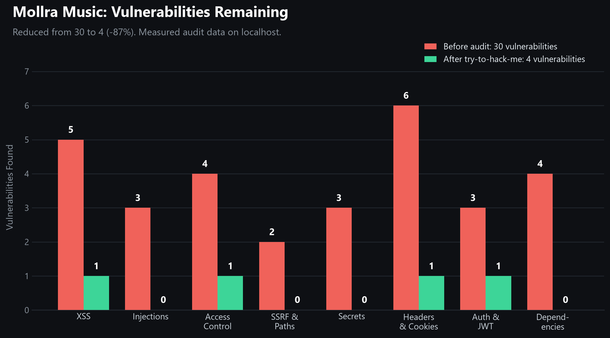

# 🛡️ Try to Hack Me

[](LICENSE)
[](https://github.com/1mN1kOo/try-to-hack-me)
[](#-scope--safety)

**An AI agent skill that attacks your own web project, proves each hole with harmless probes, closes it, adds a regression test, and repeats until a full pass finds nothing open.**

Built for [Google Antigravity](https://antigravity.google) and compatible AI coding agents. One file, no dependencies: `SKILL.md`.

---

## ⚡ Quick start

```bash
mkdir -p .agents/skills/try-to-hack-me
curl -fsSL -o .agents/skills/try-to-hack-me/SKILL.md \
  https://raw.githubusercontent.com/1mN1kOo/try-to-hack-me/main/SKILL.md
```

Then ask your agent:

> *Try to hack my website and find any vulnerabilities.*

That runs an **audit** (read-only). To let it fix things:

> *Harden this app and bring the holes to zero.*

More install options (global, Claude Code) are [below](#-installation).

---

## 📊 Benchmark



| Category | Before | After |
|---|:---:|:---:|
| XSS | 5 | 1 |
| Injections | 3 | 0 |
| Access Control | 4 | 1 |
| SSRF & Paths | 2 | 0 |
| Secrets | 3 | 0 |
| Headers & Cookies | 6 | 1 |
| Auth & JWT | 3 | 1 |
| Dependencies | 4 | 0 |
| **Total** | **30** | **4** (-87%) |

Measured on one real project (Mollra Music) on localhost with an earlier version of the skill. This is a single run, not a statistical benchmark.

The four leftovers (one each in XSS, Access Control, Headers, Auth) are exactly the classes that a one-pass, code-reading approach handles worst: context-specific XSS, authorization logic, host-level headers, and token edge cases. The current version targets them directly (see [How it works](#-how-it-works)).

---

## 🔁 How it works

1. **Map** the attack surface: inputs, sinks, routes, roles, storage, third-party scripts.
2. **Scan** with existing defensive tools (`semgrep`, `npm audit`, `gitleaks`, `eslint-plugin-security`) and treat the output as leads.
3. **Trace** every input to its sink in the code.
4. **Probe** the local server with harmless marker inputs. XSS is confirmed in a headless browser, not by reading source.
5. **Fix** (fix mode only) with the smallest change that closes the whole class, not just one payload.
6. **Test**: repeat the original probe and add a regression test to your suite.
7. **Loop** over the whole project again, up to 5 passes, until a clean pass finds nothing new.
8. **Report** with a before/after summary and an explicit list of what only you or your host can close.

---

## 🎯 What it covers

| Group | Checks |
|---|---|
| **Client-side injection** | Reflected, stored, and DOM XSS probed per context (HTML, attribute, JS string, URL, CSS, template). Strict CSP with nonces and Trusted Types as the structural fix. |
| **Server-side injection** | SQL, NoSQL operators, shell, template, header (CRLF), CSV/formula injection in exports. |
| **Requests and files** | SSRF (metadata endpoint, private ranges, DNS rebinding, redirects), path traversal and LFI, unsafe uploads, unverified webhooks (HMAC, replay, idempotency). |
| **Access control** | Route x role matrix (anonymous, user A, user B, admin), IDOR, mass assignment, response field stripping, exposed DB panels, dumps and backups. Fix: deny-by-default middleware. |
| **Business logic** | Step skipping, negative amounts, coupon and invite double-use, race conditions, atomic transactions. |
| **Auth and sessions** | Password hashing (Argon2id, bcrypt, scrypt), session revocation on credential change, user enumeration, secure randomness, timing-safe comparison, rate limits. |
| **JWT and OAuth** | Fixed algorithm allowlist, negative token tests (`alg:none`, tampered payload, expired, wrong `iss`/`aud`, algorithm confusion, token issued before password change), OAuth `state`, PKCE, exact `redirect_uri`. |
| **Browser trust** | Clickjacking, CSRF, CORS (including reflected and `null` origins), open redirects, dangerous URI schemes, `postMessage` and WebSocket origin checks. |
| **Headers and cookies** | Checked on the **live response** (`curl -sI`), not in code. Ready-to-use config written for your stack (`helmet()`, `_headers`, `vercel.json`, nginx or Caddy). |
| **Secrets** | Hardcoded keys, committed `.env`, secrets leaked into client bundles, secrets in git history, exposed `.git`, source maps, debug endpoints. |
| **Dependencies** | Direct and transitive vulnerabilities, lockfile-based audit, missing SRI, pinned versions, `overrides` for patched transitives. |
| **Resource exhaustion** | ReDoS, unbounded JSON/XML depth, body and pagination limits, timeouts. |
| **DDoS readiness** | **Review only, never simulated.** CDN and origin exposure, edge rate limits, WAF and bot rules, caching without leaking private responses. |

---

## ⚙️ Audit mode vs. fix mode

| | Audit (default) | Fix |
|---|---|---|
| **Trigger phrases** | "check", "test", "audit", "find holes", "try to hack my site" | "fix", "harden", "secure", "close the holes", "bring it to zero" |
| **Edits project files** | No | Yes, minimal patches |
| **Regression tests** | No | Yes, one per closed finding |
| **Loop until clean** | Single pass | Up to 5 passes |
| **Ends with** | Report and an offer to fix | Report with before/after counts |

Ambiguous wording defaults to audit and asks before editing.

---

## 🧾 Findings registry and what "zero" means

Every finding carries exactly one status:

| Status | Meaning |
|---|---|
| `open` | Confirmed or strongly suspected, not closed. |
| `fixed+verified` | Fixed, original probe now fails, regression test exists and passes. |
| `needs-host-config` | Needs a change outside the repo (CDN, host panel, DNS, DB permissions, secret rotation). The report names the exact setting or file. |
| `untestable` | Could not be checked here, with the reason. |

**"0 open" means zero in the tested area, not zero vulnerabilities.** The report always lists `needs-host-config` and `untestable` items next to it.

Example report header:

```text
Passes: 3 | open 0 | fixed+verified 26 | needs-host-config 3 | untestable 2
Before: 30 open -> After: 0 open (tested area)

HIGH  A-04  routes/orders.js:58
  IDOR: user A can read user B's order via /api/orders/:id
  Fix: deny-by-default middleware + owner check
  Test: security.test.js > "A-04 order owner only" (passes)
```

---

## 🧰 Tools it may run

Only existing, well-known defensive tools, only against your local project:

- `semgrep`, `eslint-plugin-security`: static patterns
- `npm audit` (or the ecosystem equivalent): dependency advisories
- `gitleaks` or `trufflehog`: secrets, including git history
- Playwright (headless): confirms whether an XSS probe actually executed

No exploit frameworks, offensive scanners, fuzzers, or brute-forcers. Ever.

---

## 🔒 Scope & safety

- **Localhost and local code only.** Never probes remote services or live production, even if you paste a URL, unless you state it is yours and the environment allows it.
- **Harmless probes.** Unique marker strings such as `window.__xss=1`. No destructive payloads.
- **No floods, no brute force, no load tests.** Rate-limit checks are capped at 15 sequential requests to localhost. DDoS protection is judged from configuration only.
- **Automatic cleanup.** Probe data is tagged with a marker and deleted afterwards, then verified with `git status` or a before/after comparison.
- **Privacy.** Real secrets and personal data found along the way are reported by location, never read out or stored.
- **No code comments.** Fixes are applied without adding comments to your code.

---

## 📦 Installation

### Project-specific (shared with your team)

```bash
mkdir -p .agents/skills/try-to-hack-me
curl -fsSL -o .agents/skills/try-to-hack-me/SKILL.md \
  https://raw.githubusercontent.com/1mN1kOo/try-to-hack-me/main/SKILL.md
```

### Global (all projects, Antigravity)

```bash
# Linux / macOS
mkdir -p ~/.gemini/antigravity/skills/try-to-hack-me
curl -fsSL -o ~/.gemini/antigravity/skills/try-to-hack-me/SKILL.md \
  https://raw.githubusercontent.com/1mN1kOo/try-to-hack-me/main/SKILL.md
```

```powershell
# Windows (PowerShell)
New-Item -ItemType Directory -Force -Path "$HOME\.gemini\antigravity\skills\try-to-hack-me"
Invoke-WebRequest -Uri "https://raw.githubusercontent.com/1mN1kOo/try-to-hack-me/main/SKILL.md" `
  -OutFile "$HOME\.gemini\antigravity\skills\try-to-hack-me\SKILL.md"
```

### Claude Code

```bash
mkdir -p .claude/skills/try-to-hack-me
curl -fsSL -o .claude/skills/try-to-hack-me/SKILL.md \
  https://raw.githubusercontent.com/1mN1kOo/try-to-hack-me/main/SKILL.md
```

### Example prompts

- *Try to hack my website and find any vulnerabilities.*
- *Run a security audit on this project.*
- *Check my endpoints for SSRF, SQL injection, and XSS.*
- *Harden this application and fix any security holes.*
- *Bring the vulnerabilities to zero.*

---

## ⚠️ Limitations

- A front-end-only project cannot prove server-side safety.
- Local probes do not replace a professional penetration test. If your project handles payments or personal data, get one.
- Anything the skill cannot run (no server, no backend code, no network) is listed as `untestable`, not assumed safe.
- An untested DDoS setup is not the same as a vulnerable one. Real load testing must go through your hosting provider or a dedicated service.

---

## 🤝 Contributing

Issues and PRs are welcome. Useful contributions: new attack classes, framework-specific fix snippets, and benchmark results on other projects (please include the skill version and what was measured).

## 📄 License

[MIT](LICENSE). Created by **[1mN1kO](https://github.com/1mN1kOo)**.
